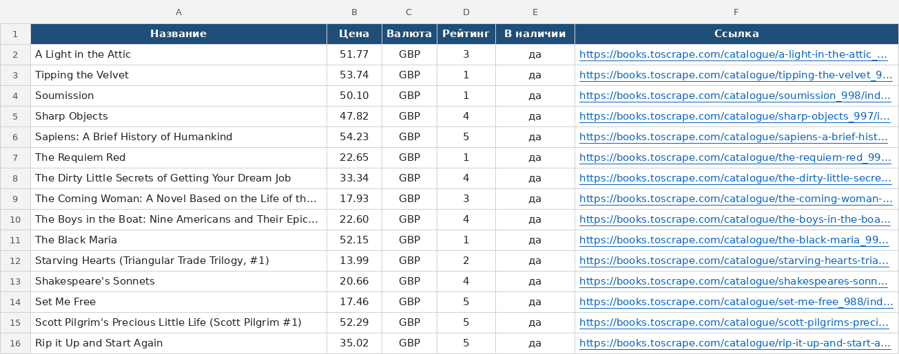

# Парсер книжного каталога → Excel и CSV

Скрипт собирает все книги с учебного сайта [books.toscrape.com](https://books.toscrape.com)
и сохраняет их в аккуратную таблицу Excel и в CSV. Можно выбрать категорию и
ограничить число страниц.



## Что умеет

- Проходит по всем страницам каталога или категории (кнопка «next»).
- Для каждой книги собирает **название, цену, валюту, рейтинг (1–5), наличие и ссылку**.
- Excel: шапка с заливкой, закреплённая первая строка, автофильтр,
  кликабельные ссылки, числовой формат цены.
- CSV в UTF-8 с BOM и разделителем `;`: открывается в Excel без «кракозябр».
- Повторяет запрос при обрыве сети и ответах 429/5xx (паузы 1, 2, 4… с),
  вежливая пауза между страницами.
- Пишет лог в консоль и в `logs/parser.log`.
- Понятные ошибки: неизвестная категория, недоступный сайт, пустой результат.

Весь каталог (1000 книг, 50 страниц) собирается примерно за 30 секунд.

## Запуск

```bash
python3 -m venv .venv
.venv/bin/pip install -r requirements.txt

.venv/bin/python books_parser.py                          # весь каталог → books.xlsx + books.csv
.venv/bin/python books_parser.py --category travel        # одна категория
.venv/bin/python books_parser.py -c "Science Fiction" -p 2 -o output/scifi
.venv/bin/python books_parser.py --list-categories        # список категорий
```

| Аргумент | Что делает |
|---|---|
| `-c`, `--category` | категория (без учёта регистра), по умолчанию весь каталог |
| `-p`, `--pages` | лимит страниц, `0` — все |
| `-o`, `--output` | имя файла без расширения, создаст `.xlsx` и `.csv` |
| `--delay` | пауза между страницами в секундах (0.3) |
| `--log` | путь к файлу лога (`logs/parser.log`) |
| `-v` | подробный лог (каждый запрос) |

Пример вывода:

```
2026-10-16 08:27:08 INFO    Старт: travel, лимит страниц: нет
2026-10-16 08:27:08 INFO    Страница 1: 11 книг (всего 11)
2026-10-16 08:27:08 INFO    Готово: 11 книг за 0.1 с → output/travel.xlsx, output/travel.csv
```

## Тесты

```bash
.venv/bin/pip install pytest
.venv/bin/pytest -q
```

Проверяют разбор карточек, цен, рейтинга, пагинации, категорий и запись файлов
на сохранённом фрагменте HTML, без обращения к сайту.

## Стек

Python 3.9+, requests (повторы через urllib3 Retry), BeautifulSoup 4, openpyxl, argparse, logging.

## Структура

```
books_parser.py      # весь парсер: сеть, разбор, сохранение, CLI
tests/test_parser.py # тесты на фрагменте HTML
docs/result.png      # скриншот результата
requirements.txt
```
